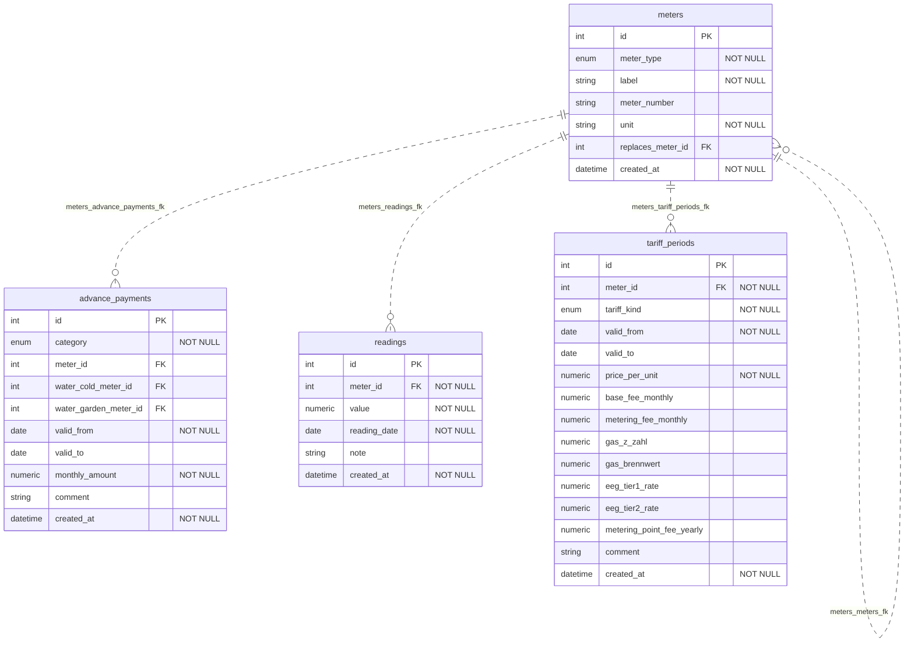

# Home Energy Usage Tracker

A simple, local application for tracking electricity, gas, and water consumption in your household.

## Features

- **Track multiple meters**: Gas, cold/garden water (m³), electricity import/export/production (kWh) — the unit is derived automatically from the meter type
- **Record readings**: Simple form to add meter readings with dates and optional notes
- **Visualize consumption**: Line charts showing usage trends over time, with toggle between absolute meter readings and cumulative consumption since Jan 1 (starts at 0, even-number axis bounds)
- **Tariff management**: Track price per unit and base fees for different periods, with optional comment field for provider name and category filter buttons (Strom Bezug/Gas/Wasser) in the list view
- **Advance payment management**: Track monthly Abschläge per meter with category (gas, cold water, wastewater, power import), time-range validity, overlap protection, optional comment field, and an "Alle" button showing all categories at once in the list view
- **Meter replacement chain**: When a physical meter is swapped, link the new meter to its predecessor via `replaces_meter_id`. Cost calculations automatically follow the chain, summing each meter's contribution — no negative consumption from a counter reset on the new device
- **Advance payment comparison**: Compare paid/planned monthly Abschläge against the estimated or actual annual cost to see whether you'll receive a refund (Guthaben) or owe a Nachzahlung
- **Local deployment**: All data stays on your machine, no cloud services
- **No authentication**: Single-user, local operation only

## Tech Stack

### Backend
- **Python 3.11** with FastAPI
- **SQLAlchemy 2.0** with mapped_column syntax
- **PostgreSQL 16** database
- **Pydantic v2** for data validation
- **Alembic** for database migrations
- **uv** as package manager

### Frontend
- **React 18** with TypeScript
- **Vite** for build tooling
- **shadcn/ui** for UI components
- **Recharts** for data visualization
- **Tailwind CSS** for styling

### Deployment
- **Docker Compose** with 3 services
- **PostgreSQL** database container
- **FastAPI** backend container
- **React** frontend container

## Getting Started

### Prerequisites
- Docker and Docker Compose
- (Optional) Node.js 18+ and Python 3.11+ for local development

### Quick Start with Docker

1. Clone the repository:
   ```bash
   git clone https://codeberg.org/Kamlkatze/home-energy-usage-tracker.git
   cd home-energy-usage-tracker
   ```

2. Copy environment variables:
   ```bash
   cp .env.example .env
   ```

3. Start all services:
   ```bash
   docker compose up -d
   ```

4. Access the application:
    - Frontend: http://localhost:3000
    - Backend API: http://localhost:8000
    - API Documentation: http://localhost:8000/docs

### Environment Configuration

The application uses a centralized `.env` file for configuration. When you copy `.env.example` to `.env`, you can customize these settings:

**Database Configuration:**
```bash
POSTGRES_USER=postgres
POSTGRES_PASSWORD=postgres
POSTGRES_DB=energy_tracker
POSTGRES_DB_TEST=energy_tracker_test  # for development/testing
```

**Network Configuration:**
```bash
DATABASE_HOST=localhost  # for native development (outside Docker)
DATABASE_PORT=5432
```

**Backend Configuration:**
```bash
API_V1_PREFIX=/api
PROJECT_NAME=Home Energy Usage Tracker
CORS_ORIGINS=["http://localhost:3000", "http://localhost:5173"]
```

**Frontend Configuration (native development only):**
```bash
VITE_API_URL=http://localhost:8000  # only used outside Docker
```

**How it works:**
- Docker Compose files use `${VARNAME:-default}` substitution to load values from `.env`
- Database URLs (`DATABASE_URL`, `DATABASE_URL_ASYNC`) are automatically constructed from the credentials
- In production, `VITE_API_URL` is hardcoded to `/api` for nginx proxy routing
- In development, `VITE_API_URL` is empty for relative API calls through Vite proxy

### Native Development (Without Docker)

If you prefer to run services directly without Docker:

1. **Setup Database:**
   ```bash
   docker compose up db -d  # or use a locally installed PostgreSQL
   ```

2. **Setup Backend:**
   ```bash
   cd backend
   uv venv
   source .venv/bin/activate  # On Windows: .venv\Scripts\activate
   uv pip install -e .
   ```

3. **Setup Frontend:**
   ```bash
   cd frontend
   npm install
   ```

4. **Start Services:**
   ```bash
   # In terminal 1: Backend
   cd backend
   uv run uvicorn app.main:app --reload

   # In terminal 2: Frontend
   cd frontend
   npm run dev
   ```

5. **Access:**
   - Frontend: http://localhost:5173
   - Backend API: http://localhost:8000
   - API Documentation: http://localhost:8000/docs

**Note:** The `.env` file must have `DATABASE_HOST=localhost` and `VITE_API_URL=http://localhost:8000` for native development.

### Local Development with Docker

For full Docker development (hot-reload for both frontend and backend):

1. Start development stack:
   ```bash
   docker compose -f docker-compose.dev.yml up -d
   ```

2. Access:
   - Frontend: http://localhost:3000 (Vite dev server with hot reload)
   - Backend: http://localhost:8000/docs (FastAPI with auto-reload)

**Key differences in development setup:**
- Frontend: Vite dev server on port 3000 (not nginx)
  - Backend: Auto-reload enabled for code changes
  - Database: Healthcheck ensures backend waits for ready DB
  - Volumes: Code is mounted for live editing
  - Proxy Configuration:
    - Docker dev: API calls go through Vite proxy to `backend:8000`
    - Native dev: API calls go directly to `localhost:8000` (no Vite proxy)
    - Production: API calls go through nginx proxy to `backend:8000`

#### Backend Setup

### Stopping the Stacks

#### Dev Stack (docker-compose.dev.yml)

The Dev Stack includes these containers:
- `home-energy-usage-tracker_frontend_1` - Frontend development server (Vite)
- `home-energy-usage-tracker_backend_1` - Backend FastAPI server with hot-reload
- `home-energy-usage-tracker_db_1` - PostgreSQL main database
- `home-energy-usage-tracker_db-test_1` - PostgreSQL test database

**Stop the Dev Stack:**

```bash
# Stop and remove all Dev Stack containers
docker compose -f docker-compose.dev.yml down

# Stop containers without removing (for faster restart)
docker compose -f docker-compose.dev.yml stop
```

#### Prod Stack (docker-compose.yml)

The Prod Stack includes these containers:
- `home-energy-usage-tracker_frontend_1` - Frontend production build (nginx)
- `home-energy-usage-tracker_backend_1` - Backend production (uvicorn)
- `home-energy-usage-tracker_db_1` - PostgreSQL main database

**Stop the Prod Stack:**

```bash
# Stop and remove all Prod Stack containers
docker compose down

# Stop containers without removing
docker compose stop
```

**⚠️ Data Loss Warning:** `docker compose down` **removes containers but keeps volumes**. `docker compose down -v` removes volumes and all data!

#### General Commands

```bash
# Show container status
docker compose -f docker-compose.dev.yml ps
docker compose ps

# View logs of all containers
docker compose -f docker-compose.dev.yml logs

# Follow logs (Ctrl+C to stop)
docker compose -f docker-compose.dev.yml logs -f

# Show all containers for this app
docker ps -a --filter name=home-energy-usage-tracker
```

For troubleshooting and advanced shutdown options, see the complete documentation in [DOCKER_SHUTDOWN.md](DOCKER_SHUTDOWN.md).

## API Endpoints

### Meters
- `GET /api/meters/current` - Return only current (non-replaced) meters — newest in each replacement chain plus standalone meters. Used by the frontend to show only active meters.
- `GET /api/meters/types` - List all meter types with German label and fixed unit. Example response:
  ```json
  [
    { "value": "gas", "label": "Gas", "unit": "m³" },
    { "value": "water_cold", "label": "Kaltwasser", "unit": "m³" },
    { "value": "water_garden", "label": "Gartenwasser", "unit": "m³" },
    { "value": "electricity_import", "label": "Strom Bezug", "unit": "kWh" },
    { "value": "electricity_export", "label": "Strom Einspeisung", "unit": "kWh" },
    { "value": "electricity_production", "label": "Strom Erzeugung", "unit": "kWh" }
  ]
  ```
- `GET /api/meters/` - List all meters
- `POST /api/meters/` - Create a new meter (optional field: `replaces_meter_id` — must reference an existing meter of the same type, self-references return **422**)
- `GET /api/meters/{id}` - Get meter details
- `PUT /api/meters/{id}` - Update meter (same validation for `replaces_meter_id` applies; changing `meter_type` is rejected with **422** when readings exist for this meter)
- `DELETE /api/meters/{id}` - Delete meter
- `GET /api/meters/{id}/readings` - Get readings for a meter
- `GET /api/meters/{id}/projection` - Get annual consumption projection for a meter (see [Projection Endpoint](#projection-endpoint))

### Readings
- `GET /api/readings/` - List all readings
- `POST /api/readings/` - Create a new reading
- `GET /api/readings/{id}` - Get reading details
- `PUT /api/readings/{id}` - Update reading
- `DELETE /api/readings/{id}` - Delete reading

### Tariff Periods
- `GET /api/tariffs/` - List all tariff periods (optional query parameter: `tariff_kind`)
- `POST /api/tariffs/` - Create a new tariff period (optional `comment` field for provider name)
- `GET /api/tariffs/{id}` - Get tariff period details
- `GET /api/tariffs/{tariff_id}/usage` - Get tariff usage info (reading count within validity range, across the full meter chain)
- `PUT /api/tariffs/{id}` - Update tariff period (including `comment`)
- `DELETE /api/tariffs/{id}` - Delete tariff period

#### TariffKind Values
- `consumption` - Price per unit for consumption (may include optional `base_fee_monthly` and `metering_fee_monthly`)
- `feed_in` - Simple feed-in tariff
- `feed_in_eeg2009` - EEG 2009 feed-in tariff (includes `eeg_tier1_rate`, `eeg_tier2_rate`, `metering_point_fee_yearly`)
- `self_consumption` - Self-consumption rate
- `wastewater` - Price per unit for wastewater (billed on the cold-water meter)

Note: Previously separate `base_fee` and `metering_fee` tariff kinds have been merged into the `consumption` tariff kind as optional monthly fee fields.

#### Example POST /api/tariffs/ request:
```json
{
  "meter_id": 1,
  "tariff_kind": "consumption",
  "valid_from": "2024-01-01",
  "valid_to": "2024-12-31",
  "price_per_unit": "0.3567",
  "base_fee_monthly": "15.50",
  "metering_fee_monthly": "5.80",
  "comment": "Stadtwerke Musterstadt"
}
```

#### Example GET /api/tariffs/?tariff_kind=consumption response:
```json
[
  {
    "id": 1,
    "meter_id": 1,
    "tariff_kind": "consumption",
    "valid_from": "2024-01-01",
    "valid_to": "2024-12-31",
    "price_per_unit": "0.3567",
    "base_fee_monthly": "15.50",
    "metering_fee_monthly": "5.80",
    "created_at": "2024-01-01T12:00:00Z"
  }
]
```

### Advance Payments
- `GET /api/advance-payments/` - List all advance payments (optional query parameters: `meter_id`, `category`)
- `POST /api/advance-payments/` - Create a new advance payment (optional `comment` field)
- `GET /api/advance-payments/{id}` - Get advance payment details
- `PUT /api/advance-payments/{id}` - Update advance payment (including `comment`)
- `DELETE /api/advance-payments/{id}` - Delete advance payment

Each advance payment carries a `category` (`gas`, `cold_water`, `wastewater`, `power_import`) that determines which meter reference is used:
- **Non-wastewater categories** (`gas`, `cold_water`, `power_import`): reference the meter via `meter_id`. `water_cold_meter_id` and `water_garden_meter_id` must be null (422 otherwise).
- **`wastewater`**: `meter_id` must be null, `water_cold_meter_id` is required. `water_garden_meter_id` is optional — when omitted, the entire cold-water consumption counts as wastewater.

**DB constraints:**
- `ck_advance_payment_wastewater`: `NOT (category = 'wastewater') OR (meter_id IS NULL AND water_cold_meter_id IS NOT NULL)`
- `ck_advance_payment_non_wastewater`: `(category = 'wastewater') OR (meter_id IS NOT NULL AND water_cold_meter_id IS NULL AND water_garden_meter_id IS NULL)`
- Overlap prevention via partial EXCLUDE constraints: non-wastewater periods must not overlap for the same `(meter_id, category)`; wastewater periods must not overlap for the same `water_cold_meter_id`

#### Example POST /api/advance-payments/ request (non-wastewater):
```json
{
  "category": "power_import",
  "meter_id": 1,
  "valid_from": "2024-01-01",
  "valid_to": "2024-12-31",
  "monthly_amount": "120.00",
  "comment": "Stadtwerke Musterstadt"
}
```

#### Example POST /api/advance-payments/ request (wastewater):
```json
{
  "category": "wastewater",
  "water_cold_meter_id": 2,
  "water_garden_meter_id": 3,
  "valid_from": "2024-01-01",
  "valid_to": "2024-12-31",
  "monthly_amount": "85.00"
}
```

#### Example GET /api/advance-payments/ response:
```json
[
  {
    "id": 1,
    "category": "power_import",
    "meter_id": 1,
    "water_cold_meter_id": null,
    "water_garden_meter_id": null,
    "valid_from": "2024-01-01",
    "valid_to": "2024-12-31",
    "monthly_amount": "120.00",
    "comment": null,
    "created_at": "2024-01-01T12:00:00Z"
  }
]
```

### Costs
- `GET /api/costs/?meter_id={id}&from={date}&to={date}` - Calculate the consumption cost for one meter between two dates (query parameters: `meter_id`, `from`, `to`). Returns **404** when no reading or no covering tariff period is found, **422** when `from > to` or the computed consumption is negative.

**Multi-period support:** If the date range spans multiple tariff periods, consumption is allocated proportionally by days in each overlapping period. The `price_per_unit` field in the response shows the first period's price for backward compatibility; the total cost correctly accounts for all periods.

**Meter replacement chain support:** If the requested meter has a `replaces_meter_id` (directly or transitively), the endpoint automatically follows the chain. Consumption is computed as the sum of each meter's contribution over its active segment (determined by the first reading date of the successor). Tariffs are looked up per meter in the chain so a tariff change at the predecessor is fully reflected. Rounding happens only once at the final output boundary — never per segment — to avoid accumulated cent errors.

#### Example GET /api/costs/?meter_id=1&from=2024-01-10&to=2024-03-10 response:
```json
{
  "meter_id": 1,
  "from_date": "2024-01-10",
  "to_date": "2024-03-10",
  "consumption": "150.500",
  "unit": "kWh",
  "price_per_unit": "0.35490",
  "base_fee_total": "25.00",
  "total_cost": "78.41"
}
```

- `GET /api/costs/wastewater/?water_cold_meter_id={id}&water_garden_meter_id={id}&from={date}&to={date}` - Calculate the wastewater cost between two dates. Wastewater is a derived value, not a real meter: `wastewater_consumption = max(0, cold-water consumption - garden-water consumption)`, billed against a `wastewater` tariff period attached to the **cold-water meter's** id (query parameters: `water_cold_meter_id`, `water_garden_meter_id` (optional), `from`, `to`). Returns **404** when no reading or no covering wastewater tariff period is found, **422** when `from > to` or the cold-water consumption is negative. Supports multiple tariff periods like the main cost endpoint.

#### Garden meter omitted vs. garden meter without readings (important distinction)
- **`water_garden_meter_id` omitted entirely**: treated as "no garden meter installed". `garden_consumption = 0` and the entire cold-water consumption counts as wastewater. No garden readings are required. `water_garden_meter_id` is `null` in the response.
- **`water_garden_meter_id` provided**: the garden meter's start/end readings are looked up with the exact same rule as the cold meter. If the garden meter has **no readings in the range**, the endpoint returns **404** ("Kein Zählerstand im angegebenen Zeitraum gefunden.") — the client explicitly claimed this meter is relevant, so silently treating it as 0 would be wrong.
- A garden consumption exceeding the cold consumption is a data quality issue that is not validated here; `wastewater_consumption` is simply floored at 0.

#### Example GET /api/costs/wastewater/?water_cold_meter_id=1&water_garden_meter_id=2&from=2024-01-10&to=2024-03-10 response:
```json
{
  "water_cold_meter_id": 1,
  "water_garden_meter_id": 2,
  "from_date": "2024-01-10",
  "to_date": "2024-03-10",
  "cold_consumption": "150.500",
  "garden_consumption": "59.500",
  "wastewater_consumption": "91.000",
  "unit": "m³",
  "price_per_unit": "2.10000",
  "base_fee_total": "12.00",
  "total_cost": "203.10"
}
```

### EEG 2009 Feed-in Compensation
- `GET /api/electricity/feed-in-compensation?production_meter_id={id}&export_meter_id={id}&import_meter_id={id}&from={date}&to={date}` - Calculate the feed-in compensation according to EEG 2009 § 33 Abs. 2. Three meter IDs are accepted as query parameters with no fixed DB relationship (analogous to the wastewater endpoint). `import_meter_id` is accepted for future extensibility but currently unused.
- `GET /api/electricity/feed-in-compensation-projection?production_meter_id={id}&export_meter_id={id}&year={year}` - Projected annual feed-in compensation for a full year, using linear projections for both production and export consumption.

**Calculation (EEG 2009 § 33 Abs. 2):**
  P = production_consumption (total generation)
  E = export_consumption (electricity fed into grid)
  S = max(0, P − E) (self-consumption)
  tier1_kwh = min(S, 0.3 × P)
  tier2_kwh = max(0, S − 0.3 × P)
  Total = P × price_per_unit − tier1_kwh × eeg_tier1_rate − tier2_kwh × eeg_tier2_rate − days × metering_point_fee_yearly / 365

The 30 % threshold is a fixed statutory value from EEG 2009 § 33 Abs. 2, not configurable. The tariff is attached to the **export meter** (`tariff_kind=feed_in_eeg2009`). Returns **404** when a meter does not exist, has no readings in the range, or no active EEG 2009 feed-in tariff is found. Returns **422** when `from > to` or consumption is negative.

**Known limitation:** Meter-replacement-chain support is NOT implemented for this endpoint (first iteration).

#### Example GET /api/electricity/feed-in-compensation?production_meter_id=1&export_meter_id=2&from=2024-01-10&to=2024-03-10 response:
```json
{
  "production_meter_id": 1,
  "export_meter_id": 2,
  "from_date": "2024-01-10",
  "to_date": "2024-03-10",
  "production_consumption": "4500.000",
  "export_consumption": "2800.000",
  "self_consumption": "1700.000",
  "tier1_kwh": "1350.000",
  "tier2_kwh": "350.000",
  "total_compensation": "987.65"
}
```

### Yearly Projection with Cost
- `GET /api/costs/yearly-projection?meter_id={id}&year={year}&as_of_date={date}` - Combine annual consumption projection with cost calculation. The `as_of_date` parameter is optional, defaults to server date (datetime.now(UTC).date()). Returns **200 OK** even with insufficient data or missing tariff, **404** if meter not found, **422** for invalid year (outside 2000-2100 range).

**Calculation Logic:**
1. **Projection**: Uses the same logic as `/api/meters/{id}/projection` to get projected annual consumption
2. **Active tariff**: Finds the consumption tariff active on `as_of_date` for the meter
3. **Actual cost**: Calculates cost from Jan 1 of `year` to `as_of_date` using existing cost calculation logic
4. **Projected cost**: Estimates annual cost using projected consumption and active tariff's rates

**Edge cases:**
- No active tariff → `projected_annual_cost = null` with explanatory message
- Insufficient data for projection → `projected_annual_cost = null` (projection basis will be "insufficient_data")
- Multiple tariff periods historically → correctly picks the one active on `as_of_date`
- Gas meter: consumption (m³) is converted to kWh via `gas_z_zahl` × `gas_brennwert` before cost calculation, for both actual and projected costs; a tariff lacking these fields → cost fields `null` with explanatory message (200)
- Actual cost unavailable (no tariff covering the period, negative consumption, missing gas factors) → `actual_cost_to_date = null` with explanatory message. If the projected path fails too, both reasons are combined into the single `message` field (deduplicated, space-separated)

#### Example GET /api/costs/yearly-projection?meter_id=1&year=2025&as_of_date=2025-06-01 response:
```json
{
  "meter_id": 1,
  "year": 2025,
  "unit": "kWh",
  "as_of_date": "2025-06-01",
  "actual_consumption_to_date": "250.500",
  "projected_annual_consumption": "601.447",
  "projected_meter_reading_end_of_year": "2675.447",
  "start_reading_value": "2074.000",
  "start_reading_date": "2024-12-31",
  "basis": "linear_from_prev_year_end",
  "actual_cost_to_date": "92.35",
  "projected_annual_cost": "221.89",
  "message": null
}
```

#### Example no active tariff response:
```json
{
  "meter_id": 1,
  "year": 2025,
  "unit": "kWh",
  "as_of_date": "2025-06-01",
  "actual_consumption_to_date": "250.500",
  "projected_annual_consumption": "601.447",
  "projected_meter_reading_end_of_year": "2675.447",
  "start_reading_value": "2074.000",
  "start_reading_date": "2024-12-31",
  "basis": "linear_from_prev_year_end",
  "actual_cost_to_date": null,
  "projected_annual_cost": null,
  "message": "Kein gültiger Tarif für diesen Zeitraum gefunden. Kein aktiver Tarif für dieses Datum gefunden."
}
```
> The `message` combines the actual-cost failure (no tariff for Jan 1 – as_of_date) and the projected-cost failure (no active tariff) into one deduplicated, space-separated string.

#### Example insufficient data response:
```json
{
  "meter_id": 1,
  "year": 2025,
  "unit": "kWh",
  "as_of_date": "2025-06-01",
  "actual_consumption_to_date": null,
  "projected_annual_consumption": null,
  "projected_meter_reading_end_of_year": null,
  "basis": "insufficient_data",
  "actual_cost_to_date": null,
  "projected_annual_cost": null,
  "message": "Nicht genügend Zählerstände im Jahr 2025 vorhanden, um eine Hochrechnung zu erstellen."
}
```

### Projection Endpoint
- `GET /api/meters/{meter_id}/projection?year={year}&as_of_date={date}` - Standalone annual consumption projection for a meter (separate from the combined yearly projection with cost above).

**Calculation Logic:**
- **Year completed** (year < as_of_date.year): Actual consumption = end.value - start.value (real yearly consumption)
- **Year ongoing** (year >= as_of_date.year): Linear projection = (actual consumption / elapsed days) * 365
- **Insufficient data**: When start/end readings missing or start >= end

**Start point determination:**
1. Preference: Reading exactly on December 31st of previous year
2. Fallback: First reading in the target year

#### Example GET /api/meters/1/projection?year=2025&as_of_date=2025-06-01 response (ongoing year):
```json
{
  "meter_id": 1,
  "year": 2025,
  "unit": "kWh",
  "actual_consumption_to_date": "250.500",
  "days_elapsed": 152,
  "projected_annual_consumption": "601.447",
  "projected_meter_reading_end_of_year": "2675.447",
  "start_reading_value": "2074.000",
  "start_reading_date": "2024-12-31",
  "basis": "linear_from_prev_year_end",
  "message": null
}
```

#### Example GET /api/meters/1/projection?year=2024 response (completed year):
```json
{
  "meter_id": 1,
  "year": 2024,
  "unit": "kWh",
  "actual_consumption_to_date": "850.250",
  "days_elapsed": 366,
  "projected_annual_consumption": "850.250",
  "projected_meter_reading_end_of_year": "2850.250",
  "start_reading_value": "2000.000",
  "start_reading_date": "2024-01-15",
  "basis": "actual_full_year",
  "message": null
}
```

#### Example insufficient data response:
```json
{
  "meter_id": 1,
  "year": 2024,
  "unit": "kWh",
  "actual_consumption_to_date": null,
  "days_elapsed": null,
  "projected_annual_consumption": null,
  "projected_meter_reading_end_of_year": null,
  "start_reading_value": null,
  "start_reading_date": null,
  "basis": "insufficient_data",
  "message": "Nicht genügend Zählerstände im Jahr 2024 vorhanden, um eine Hochrechnung zu erstellen."
}
```

**Basis values:**
- `"linear_from_prev_year_end"` - Start reading from December 31st of previous year
- `"linear_from_first_reading_of_year"` - Start reading from first reading in target year (fallback)
- `"actual_full_year"` - Year completed, actual consumption is final
- `"insufficient_data"` - Not enough readings for calculation

**Known limitations:**
- Uses only two boundary points (start/end) for linear projection, no regression over multiple intermediate values
- Does not account for seasonal consumption patterns
- Negative consumption values (meter rollover) are calculated as-is, not validated or clamped

### Years Overview
- `GET /api/costs/years-overview` - Return a years-overview for every logical meter (standalone meter or newest meter in a replacement chain). Consumption, cost, and cost basis are computed per year using the same projection and cost logic as the yearly-projection endpoint. Returns **200 OK** even when some meter/year combinations have missing tariffs or insufficient data.

**Chain resolution:** Only meters that are NOT referenced by any other meter's `replaces_meter_id` appear as top-level entries. Their consumption/cost history includes the full replacement chain.

**Response structure:** Each entry contains a list of `years` where at least one reading exists in the meter's chain. Years without readings are omitted. Cost fields are `null` when no tariff or insufficient data is available.

#### Example GET /api/costs/years-overview response:
```json
[
  {
    "meter_id": 1,
    "meter_label": "Gas Zähler",
    "meter_type": "gas",
    "unit": "m³",
    "years": [
      { "year": 2023, "consumption": "1200.500", "cost": "450.20", "cost_basis": "actual" },
      { "year": 2024, "consumption": "980.000", "cost": "410.00", "cost_basis": "projected" }
    ]
  }
]
```

### Advance Payment Diff (Cost vs. Abschläge)
- `GET /api/costs/advance-payment-diff?meter_id={id}&year={year}&as_of_date={date}` - Calculate the difference and the estimated or actual annual cost for a meter and year. `as_of_date` is optional (defaults to server date). Returns **200** even with no advance payments or no tariff, **404** if meter not found, **422** for invalid year (outside 2000-2100 range).

**Wastewater mode:** Pass `water_cold_meter_id` (and optionally `water_garden_meter_id`) to compute the diff for the `wastewater` category instead of `meter_id`:
- The annual cost is based on the wastewater consumption `max(0, cold_water_consumption - garden_water_consumption)` (same rules as the wastewater cost endpoint, including meter replacement chains) billed against a `wastewater` tariff attached to the **cold-water** meter
- `total_advance_payments` sums `category=wastewater` advance payments that reference the cold-water meter via `water_cold_meter_id`
- If `water_garden_meter_id` is omitted, `garden_consumption = 0` and the entire cold-water consumption counts as wastewater (no subtraction)
- `meter_id` in the response is the cold-water meter id

**Calculation Logic:**
1. **Annual cost** — Uses the same logic as `/api/costs/yearly-projection`:
   - Completed year: actual full-year cost from all tariffs covering the year (`cost_basis: "actual"`)
   - Ongoing/future year: projected cost using the tariff active on `as_of_date` (`cost_basis: "projected"`)
2. **Total advance payments** — Sums all `AdvancePayment` records for the meter that overlap the year, prorated by days (fixed 30-day month, same convention as `base_fee_monthly`). Each period contributes `monthly_amount × overlap_days / 30`.
3. **Difference** — `total_advance_payments - estimated_or_actual_cost` (positive = Guthaben, negative = Nachzahlung)

**Edge cases:**
- No advance payment exists → `total_advance_payments: null`, `difference: null`, message: `"Kein Abschlag für dieses Jahr hinterlegt."` (still returns 200)
- Annual cost unavailable (no tariff, insufficient data, missing gas factors) → `estimated_or_actual_cost: null`, `cost_basis: null`, `difference: null`
- Both cost and advance payment missing → combined message

#### Example GET /api/costs/advance-payment-diff?meter_id=1&year=2025&as_of_date=2025-06-01 response:
```json
{
  "meter_id": 1,
  "year": 2025,
  "estimated_or_actual_cost": "845.30",
  "cost_basis": "projected",
  "total_advance_payments": "800.00",
  "difference": "-45.30",
  "message": null
}
```

#### Example no advance payment response:
```json
{
  "meter_id": 1,
  "year": 2025,
  "estimated_or_actual_cost": "845.30",
  "cost_basis": "projected",
  "total_advance_payments": null,
  "difference": null,
  "message": "Kein Abschlag für dieses Jahr hinterlegt."
}
```

### Advance Payment Diff By Category
- `GET /api/costs/advance-payment-diff-by-category?category={cat}&year={year}&meter_id={id}&water_cold_meter_id={id}` - Thin wrapper around `advance-payment-diff` with category-based parameter validation. Adds a `category` field to the response.

### Health
- `GET /health` - Health check endpoint, returns `{"status": "healthy"}`.

## Database Schema

<!-- ERD:START -->

<!-- This section is auto-generated by scripts/generate_erd.py. Do not edit by hand. -->

<!-- Auto-generated by scripts/generate_erd.py. Do not edit by hand. -->



<!-- ERD:END -->

> **Note:** The ER diagram (Mermaid block above) is auto-generated from the SQLAlchemy models.  
> Do not edit the diagram manually — model changes are reflected by running:  
> `cd backend && uv sync --extra dev && uv run python ../scripts/generate_erd.py --update-readme`.

### Meter
- `id` (integer, primary key)
- `meter_type` (enum: electricity_import, electricity_export, electricity_production, gas, water_cold, water_garden)
- `label` (string, e.g., "Main Electricity Meter")
- `meter_number` (string, optional, e.g., "1EMH0012345678")
- `unit` (string, e.g., "kWh", "m³") - **server-derived** from `meter_type`, not client-settable: a `unit` field in a POST/PUT request body is rejected with **422 Unprocessable Entity**
- `replaces_meter_id` (integer, optional, FK → Meter.id) - links to the predecessor meter this one physically replaced; `null` for standalone meters
- `created_at` (datetime)

**Meter replacement chain:** A meter with `replaces_meter_id` set forms a 1:1 replacement chain (e.g. old meter P → new meter M). The cost and projection endpoints follow the chain automatically. Validation rules:
- `replaces_meter_id` must reference an existing meter of the **same** `meter_type` (422 otherwise)
- A meter cannot reference itself (422)
- No hard DB constraint prevents multiple successors (application logic only)
- **Changing `meter_type` via PUT is rejected (422) if readings exist for this meter**

### Reading
- `id` (integer, primary key)
- `meter_id` (foreign key to Meter)
- `value` (numeric, meter reading value)
- `reading_date` (date)
- `note` (string, optional)
- `created_at` (datetime)
- **Constraint**: Unique (meter_id, reading_date) - prevents duplicate readings on the same date

### TariffPeriod
- `id` (integer, primary key)
- `meter_id` (foreign key to Meter)
- `tariff_kind` (enum: consumption, feed_in, feed_in_eeg2009, self_consumption, wastewater)
- `valid_from` (date)
- `valid_to` (date, optional, null means "open-ended - valid until today")
- `price_per_unit` (numeric)
- `base_fee_monthly` (numeric, optional, only for consumption tariff kind)
- `metering_fee_monthly` (numeric, optional, only for consumption tariff kind)
- `gas_z_zahl` (numeric(10,5), optional, gas m³→kWh conversion factor)
- `gas_brennwert` (numeric(10,5), optional, gas m³→kWh conversion factor)
- `eeg_tier1_rate` (numeric(10,5), optional, only for feed_in_eeg2009 tariff kind)
- `eeg_tier2_rate` (numeric(10,5), optional, only for feed_in_eeg2009 tariff kind)
- `metering_point_fee_yearly` (numeric(10,2), optional, only for feed_in_eeg2009 tariff kind)
- `comment` (string(500), optional, free text for provider name or notes)
- `created_at` (datetime)
- **Constraint**: EXCLUDE USING gist (meter_id WITH =, tariff_kind WITH =, daterange(valid_from, valid_to, '[]') WITH &&)
  - Prevents overlapping periods within same (meter_id, tariff_kind)
  - Different tariff_kind values may overlap in time (e.g., consumption price and feed-in tariff can be valid simultaneously)
  - Both bounds inclusive: adjacent periods must use valid_to = day before next valid_from

### AdvancePayment
- `id` (integer, primary key)
- `category` (enum: gas, cold_water, wastewater, power_import)
- `meter_id` (foreign key to Meter, CASCADE delete, nullable — used for non-wastewater categories)
- `water_cold_meter_id` (foreign key to Meter, CASCADE delete, nullable — required for wastewater category)
- `water_garden_meter_id` (foreign key to Meter, CASCADE delete, nullable — optional for wastewater category)
- `valid_from` (date)
- `valid_to` (date, optional, null means "open-ended")
- `monthly_amount` (numeric(10,2))
- `comment` (string(500), optional, free text for provider name or notes)
- `created_at` (datetime)
- **CHECK constraints**:
  - `ck_advance_payment_wastewater`: `NOT (category = 'wastewater') OR (meter_id IS NULL AND water_cold_meter_id IS NOT NULL)`
  - `ck_advance_payment_non_wastewater`: `(category = 'wastewater') OR (meter_id IS NOT NULL AND water_cold_meter_id IS NULL AND water_garden_meter_id IS NULL)`
- **Partial EXCLUDE constraints** (overlap prevention, both bounds inclusive):
  - `excl_advance_payment_non_wastewater`: no overlapping periods for the same `(meter_id, category)`
  - `excl_advance_payment_wastewater`: no overlapping periods for the same `water_cold_meter_id`

## Development Commands

### Backend
```bash
# Run tests
 cd backend && uv run --extra dev pytest

 # Run linting
 cd backend && uv run --extra dev ruff check --fix && uv run --extra dev mypy app/models

 # Create migration
 cd backend && uv run alembic revision --autogenerate -m "description"

 # Apply migrations
 cd backend && uv run alembic upgrade head
```

### Frontend
```bash
# Run development server
cd frontend && npm run dev

# Build for production
cd frontend && npm run build

# Run linting
cd frontend && npm run lint
```

## Project Structure

```
home-energy-usage-tracker/
├── backend/
│   ├── app/
│   │   ├── api/
│   │   │   ├── __init__.py           # Router registration
│   │   │   ├── advance_payments.py   # CRUD endpoints for advance payments
│   │   │   ├── costs.py              # Cost calculation, wastewater, yearly projection,
│   │   │   │                         #   and advance-payment-diff endpoints
│   │   │   ├── deps.py               # Dependency injection (database session)
│   │   │   ├── electricity.py         # EEG 2009 feed-in compensation endpoint
│   │   │   ├── meters.py             # CRUD endpoints for meters
│   │   │   ├── projections.py        # Projection endpoints for annual consumption
│   │   │   ├── readings.py           # CRUD endpoints for readings
│   │   │   └── tariff_periods.py     # CRUD endpoints for tariff periods
│   │   ├── models/
│   │   │   ├── __init__.py           # Exports all SQLAlchemy ORM models
│   │   │   ├── advance_payment.py    # AdvancePayment ORM model
│   │   │   ├── base.py               # Base model with id and timestamp mixin
│   │   │   ├── meter.py              # Meter ORM model with MeterType enum
│   │   │   ├── reading.py            # Reading ORM model
│   │   │   └── tariff_period.py      # TariffPeriod ORM model with TariffKind enum
│   │   ├── schemas/
│   │   │   ├── __init__.py           # Exports all Pydantic schemas
│   │   │   ├── advance_payment.py    # AdvancePayment schemas (Create, Update, Response)
│   │   │   ├── cost.py               # Cost, wastewater, and advance-payment-diff schemas
│   │   │   ├── meter.py              # Meter schemas (Create, Update, Response)
│   │   │   ├── projection.py         # Projection response schema
│   │   │   ├── reading.py            # Reading schemas
│   │   │   ├── tariff_period.py      # TariffPeriod schemas with TariffKind
│   │   │   └── yearly_projection_cost.py # Yearly projection with cost response schema
│   │   ├── services/
│   │   │   └── projection.py         # Business logic for projection calculations
│   │   ├── __init__.py
│   │   ├── config.py                 # Configuration with pydantic-settings
│   │   ├── database.py               # SQLAlchemy engine and session factory
│   │   └── main.py                   # FastAPI application with middleware
│   ├── alembic/                       # Database migrations
│   ├── tests/                         # Backend tests
│   ├── pyproject.toml                # Python dependencies (uv)
│   ├── uv.lock                       # Locked dependencies
│   ├── .dockerignore
│   ├── .ruff_cache/                   # Linting cache
│   ├── .mypy_cache/                   # Type checking cache
│   └── Dockerfile                    # Production backend image
├── frontend/
│   ├── src/
│   │   ├── api/                      # API client
│   │   ├── components/               # React components (MeterList, EditMeterModal)
│   │   ├── components/ui/            # shadcn/ui components
│   │   ├── components/year-detail/    # Year detail page components (MeterBlock, ElectricitySection, WaterSection, GasSection)
│   │   ├── pages/                    # Page components
│   │   ├── types/                    # TypeScript interfaces
│   │   ├── hooks/                    # Custom React hooks
│   │   ├── lib/                      # Utility functions
│   │   ├── App.tsx                   # Main application
│   │   └── main.tsx                  # React entry point
│   ├── dist/                         # Production build output
│   ├── node_modules/                 # Node.js dependencies
│   ├── nginx.conf                    # Nginx configuration (production)
│   ├── Dockerfile                    # Production frontend image (nginx)
│   ├── Dockerfile.dev                # Development frontend image (Vite)
│   ├── package.json                  # Node.js dependencies
│   ├── package-lock.json             # Locked dependencies
│   ├── tailwind.config.js            # Tailwind CSS configuration
│   ├── postcss.config.js             # PostCSS configuration
│   └── vite.config.ts                # Vite configuration
├── docker-compose.yml                # Production Docker setup (3 services)
├── docker-compose.dev.yml            # Development Docker setup (4 services with test DB)
├── .env.example                      # Environment variables template
├── AGENTS.md                         # Agent instructions for this project
└── README.md                         # This file
```

## Security Note

This application is designed for **local, single-user operation only**. It does not include:
- User authentication
- Role-based access control
- HTTPS (in local deployment)
- Rate limiting
- Input sanitization beyond basic validation

For production use with multiple users or internet exposure, additional security measures are required.

## Troubleshooting

### Environment Variable Issues

If services fail to connect or use incorrect database URLs:

1. **Check `.env` file exists:** Make sure `.env.example` was copied to `.env`
2. **Verify Docker Compose substitution:** 
   - Production: `docker compose config` shows resolved environment variables
   - Development: `docker compose -f docker-compose.dev.yml config`
3. **Database connection issues:**
   - Docker containers: URLs use `db` hostname (e.g., `postgresql://postgres:postgres@db:5432/energy_tracker`)
   - Native development: URLs use `localhost` hostname (matches `.env` file)
   - Ensure `DATABASE_HOST` is `localhost` for native dev, `db` for Docker

### Docker Container Hangs on Stop

If containers hang during shutdown with `SIGTERM failed to stop container ... resorting to SIGKILL`:
- Fixed: Backend uses `exec` to make uvicorn PID 1 for clean SIGTERM handling
- Fixed: Frontend uses `exec` for nginx (production) and npm (development)  
- Check: Both `docker-compose.yml` and `docker-compose.dev.yml` use `exec` in backend command
- Check: Dockerfiles use `exec` in CMD for frontend services
- Works with: Production (nginx proxy) and Development (hot-reload) setups
- Containers now stop within Docker/Podman timeout (usually 10s)

### Database Migration Issues

If you encounter `type "metertype" already exists` errors:
- The migration creates the PostgreSQL enum type automatically with the `meters` table
- If you see duplicate type creation errors, check that the migration doesn't create the enum both explicitly and implicitly
- To reset: `docker compose down --volumes` (⚠️ **deletes all data**)

### Podman-Specific Issues

This project works with both Docker and Podman. On Linux with Podman:

- Containers may be managed via systemd: `systemctl --user status podman-compose@home-energy-usage-tracker.service`
- If containers hang, check podman logs: `podman logs <container_name>`
- For rootful podman, you may need `sudo` for socket access

### API Endpoints Return 500 with Enum Errors

If POST requests fail with `invalid input value for enum metertype: "ELECTRICITY"`:
- SQLAlchemy persists enum member **names** by default (e.g., `ELECTRICITY`)
- The database stores **values** (`electricity`)
- Fix: Add `values_callable=lambda e: [m.value for m in e]` to SQLAlchemy Enum columns

### Frontend Build Issues

If TypeScript errors appear during frontend build:
- Ensure `frontend/src/vite-env.d.ts` exists with `/// <reference types="vite/client" />`
- Check for missing dependencies: `cd frontend && npm install`

## Backup & Restore

### Data Backup
To export your energy tracking data (schema is created via Alembic on the target system):

```bash
# Find your database container name
podman ps | grep postgres

# Export data only (schema comes from Alembic on the target system)
podman exec <db-container> pg_dump -U postgres -d energy_tracker \
  --data-only --column-inserts > energy_data_backup.sql
```

### Data Restore
To import data on the target system (after `alembic upgrade head` has run there):

```bash
# Find your database container name on the target system
podman ps | grep postgres

# Import the backup
cat energy_data_backup.sql | podman exec -i <db-container> \
  psql -U postgres -d energy_tracker
```

**Note**: This exports only data, not schema. The schema must be created separately via Alembic migrations (`alembic upgrade head`).

## License

MIT License

## Contributing

1. Fork the repository
2. Create a feature branch
3. Make your changes
4. Add tests if applicable
5. Submit a pull request